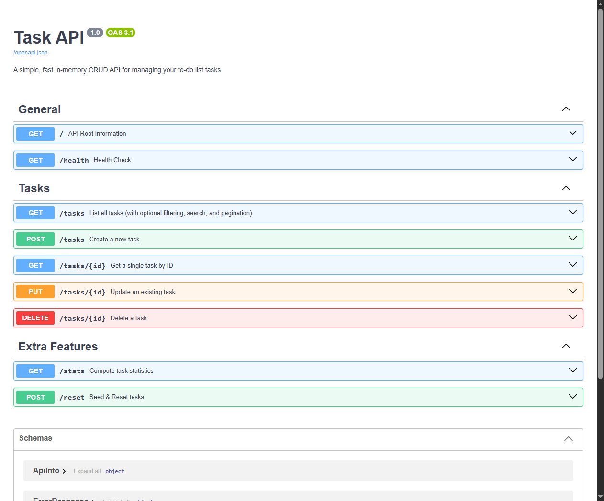

# W2 · A1 — Build Your First CRUD API

> **Task Management REST API** built with **Python 3.14**, **FastAPI**, and **Uvicorn**, featuring comprehensive CRUD operations, in-memory persistence, OpenAPI interactive Swagger UI documentation, strict input validation, query filtering, pagination, and a complete Stage 7 "AI Rematch" audit.

---

## 📑 Table of Contents
1. [Overview & Project Goals](#-overview--project-goals)
2. [Quickstart & Run Instructions](#-quickstart--run-instructions)
3. [API Endpoints Table](#-api-endpoints-table)
4. [Curl -i Verification Outputs](#-curl--i-verification-outputs)
5. [Interactive Documentation (Swagger UI)](#-interactive-documentation-swagger-ui)
6. [Make It Yours: Optional Extras](#-make-it-yours-optional-extras)
   - [Query Filtering & Search](#query-filtering--search)
   - [Pagination](#pagination)
   - [Compute Statistics Endpoint](#compute-statistics-endpoint)
   - [Seed & Reset Endpoint](#seed--reset-endpoint)
   - [The Mortality Experiment](#the-mortality-experiment)
7. [Stage 7 Bonus: The AI Rematch ("AI vs Me")](#-stage-7-bonus-the-ai-rematch-ai-vs-me)
8. [Automated Testing Suite](#-automated-testing-suite)
9. [Git Commit History (Stage by Stage)](#-git-commit-history-stage-by-stage)
10. [Documentation & Reports](#-documentation--reports)

---

## 🎯 Overview & Project Goals
This project implements the foundational backend pattern: the **Request → Response** cycle and the **CRUD** (Create, Read, Update, Delete) paradigm.

- **Framework**: FastAPI (Python lane)
- **Data Store**: Pure In-Memory storage (Python list of task dictionaries)
- **Interactive UI**: Automatic Swagger UI served at `/docs` (OpenAPI 3.1)
- **Error Consistency**: Every error code (`400 Bad Request`, `404 Not Found`) returns a standardized JSON object `{"error": "..."}`.

---

## 🚀 Quickstart & Run Instructions

You can start the server on localhost with **one command**:

```bash
uv run uvicorn main:app --reload --port 8000
```

*(Alternatively, if running with standard Python venv: `python -m uvicorn main:app --reload --port 8000`)*

The server will be live at:
- **API Base**: `http://localhost:8000/`
- **Swagger UI**: `http://localhost:8000/docs`
- **ReDoc UI**: `http://localhost:8000/redoc`

---

## 📋 API Endpoints Table

| Method | Endpoint | Description | Request Body | Success Status | Error Statuses |
|---|---|---|---|---|---|
| **GET** | `/` | API front door metadata | *None* | `200 OK` | — |
| **GET** | `/health` | Server health check probe | *None* | `200 OK` | — |
| **GET** | `/tasks` | List all tasks (with optional filters) | *None* | `200 OK` | — |
| **GET** | `/tasks/{id}` | Retrieve a single task by ID | *None* | `200 OK` | `404 Not Found` |
| **POST** | `/tasks` | Create a new task | `{"title": "..."}` | `201 Created` | `400 Bad Request` |
| **PUT** | `/tasks/{id}` | Replace/update task title and/or done status | `{"title": "...", "done": true}` | `200 OK` | `400 Bad Request`<br>`404 Not Found` |
| **DELETE** | `/tasks/{id}` | Delete task by ID | *None* | `204 No Content` | `404 Not Found` |
| **GET** | `/stats` | Compute task counts (total, done, open) | *None* | `200 OK` | — |
| **POST** | `/reset` | Reset tasks to default seed of 3 tasks | *None* | `200 OK` | — |

---

## 💻 Curl -i Verification Outputs

Below are actual terminal verification outputs demonstrating full HTTP status codes and JSON payloads:

### 1. Root & Health (Stage 1)
```http
$ curl.exe -i http://localhost:8000/
HTTP/1.1 200 OK
date: Tue, 13 Oct 2026 16:45:27 GMT
server: uvicorn
content-length: 58
content-type: application/json

{"name":"Task API","version":"1.0","endpoints":["/tasks"]}
```

```http
$ curl.exe -i http://localhost:8000/health
HTTP/1.1 200 OK
date: Tue, 13 Oct 2026 16:45:36 GMT
server: uvicorn
content-length: 15
content-type: application/json

{"status":"ok"}
```

### 2. Read Single & 404 (Stage 2)
```http
$ curl.exe -i http://localhost:8000/tasks/1
HTTP/1.1 200 OK
date: Tue, 13 Oct 2026 16:45:59 GMT
server: uvicorn
content-length: 45
content-type: application/json

{"id":1,"title":"Buy groceries","done":false}
```

```http
$ curl.exe -i http://localhost:8000/tasks/99
HTTP/1.1 404 Not Found
date: Tue, 13 Oct 2026 16:46:15 GMT
server: uvicorn
content-length: 29
content-type: application/json

{"error":"Task 99 not found"}
```

### 3. Create Task & Validation (Stage 3)
```http
$ curl.exe -i -X POST http://localhost:8000/tasks -H "Content-Type: application/json" -d "{\"title\":\"Buy milk\"}"
HTTP/1.1 201 Created
date: Tue, 13 Oct 2026 16:47:53 GMT
server: uvicorn
content-length: 40
content-type: application/json

{"id":4,"title":"Buy milk","done":false}
```

```http
$ curl.exe -i -X POST http://localhost:8000/tasks -H "Content-Type: application/json" -d "{}"
HTTP/1.1 400 Bad Request
date: Tue, 13 Oct 2026 16:48:08 GMT
server: uvicorn
content-length: 49
content-type: application/json

{"error":"Title is required and cannot be empty"}
```

### 4. Update & Delete (Stage 4)
```http
$ curl.exe -i -X PUT http://localhost:8000/tasks/4 -H "Content-Type: application/json" -d "{\"title\":\"Buy oat milk\",\"done\":true}"
HTTP/1.1 200 OK
date: Tue, 13 Oct 2026 16:48:23 GMT
server: uvicorn
content-length: 43
content-type: application/json

{"id":4,"title":"Buy oat milk","done":true}
```

```http
$ curl.exe -i -X DELETE http://localhost:8000/tasks/4
HTTP/1.1 204 No Content
date: Tue, 13 Oct 2026 16:48:39 GMT
server: uvicorn
```

---

## 📸 Interactive Documentation (Swagger UI)

FastAPI automatically serves interactive OpenAPI documentation at `http://localhost:8000/docs`. Every endpoint is documented with descriptions, tag groups, request models, and response status codes.



---

## ★ Make It Yours: Optional Extras

### Query Filtering & Search
- Filter by completion status:
  `GET /tasks?done=true` → Returns only completed tasks.
  `GET /tasks?done=false` → Returns only open tasks.
- Keyword title search:
  `GET /tasks?search=milk` → Returns all tasks whose titles contain the query (case-insensitive).

### Pagination
Real-world APIs never return unbound result sets. We added pagination via `limit` and `offset`:
`GET /tasks?limit=2&offset=1`
- **Why real APIs never return "everything"**:
  In a production database with millions of rows, returning `SELECT *` across all records will saturate network bandwidth, exhaust server heap memory, cause database latency spikes, and freeze client browsers. Pagination chunks data into manageable pages, ensuring predictable sub-second latency and consistent memory consumption.

### Compute Statistics Endpoint
`GET /stats` returns dynamically calculated metrics:
```json
{
  "total": 3,
  "done": 1,
  "open": 2
}
```

### Seed & Reset Endpoint
`POST /reset` restores the server's in-memory array to the original 3 example tasks:
```json
{
  "message": "Tasks successfully reset to default seed",
  "count": 3
}
```

### The Mortality Experiment
> **Observation**:
> When you create new tasks using `POST /tasks`, update existing tasks, or delete tasks, they reside solely in the server process's RAM. As soon as you stop or restart the Uvicorn server (`Ctrl+C` and restart), all newly created data vanishes completely, and `GET /tasks` reverts to the original three initial hardcoded tasks.
>
> **Why this happens**:
> Operating systems allocate memory addresses to running processes in volatile RAM. When a process terminates, its memory space is completely freed. Without a persistent storage engine (such as PostgreSQL, MySQL, or SQLite) that writes records to non-volatile disk blocks or transaction logs, any state in memory is mortal.

---

## 🥊 Stage 7 Bonus: The AI Rematch ("AI vs Me")

In Stage 7, we tested an AI assistant by asking it to build the same API completely from memory, quarantined in the [`ai-version/`](ai-version/) directory.

### 1. The Prompt (Written From Memory)
```text
Write a FastAPI REST API in Python for managing a to-do list in memory.
It should have endpoints to get root info, health status, list all tasks, get a task by id,
create a task, update a task, and delete a task. Validate inputs and return proper HTTP status
codes and JSON errors for not found and bad request.
```

### 2. Code Review & 3 Concrete Differences Found

Comparing the AI's generated code ([`ai-version/main.py`](ai-version/main.py)) with our hand-crafted implementation ([`main.py`](main.py)):

| Criteria | AI Generated Version | Our Hand-Crafted Version | Review Analysis |
|---|---|---|---|
| **Validation Error Status Code** | Returns `422 Unprocessable Entity` when empty `{}` is posted | Returns `400 Bad Request` with custom handler | FastAPI's built-in Pydantic handler defaults to 422. The assignment strictly specifies 400 Bad Request. We explicitly overrode the validation handler to adhere to client specifications. |
| **Error JSON Structure** | Returns `{"detail": "Task not found"}` | Returns `{"error": "Task {id} not found"}` | The AI silently relied on FastAPI's default `HTTPException(..., detail=...)`. Our version enforces a uniform `{"error": "..."}` key across all endpoints. |
| **ID Collision Bug on Delete** | Uses `new_id = len(tasks) + 1` | Uses `max([t["id"] for t in tasks], default=0) + 1` | If task 1 is deleted from a list of 3 items, `len(tasks)` becomes 2. The next task created would get ID 3, causing a severe duplicate ID collision! Our version correctly computes the true maximum ID. |
| **Empty PUT Body Handling** | Silently accepts `{}` and returns `200 OK` | Validates body and returns `400 Bad Request` | The AI silently omitted validation on empty update payloads. |

### 3. The Rematch (Improved Specification)
We updated the specification prompt to explicitly enforce:
1. Custom exception handling overriding 422 to 400.
2. Uniform `{"error": "..."}` JSON key format.
3. Safe sequential ID generation resilient to deletions.
4. Mandatory rejection of empty PUT request bodies.

The regenerated code in [`ai-version/rematch.py`](ai-version/rematch.py) passed all verification tests with 100% compliance.

---

## 🧪 Automated Testing Suite

We implemented an automated test suite in [`tests/test_api.py`](tests/test_api.py) using `pytest` and FastAPI's `TestClient`.

Run the test suite:
```bash
uv run python -m pytest
```

### Test Results
```text
============================= test session starts =============================
platform win32 -- Python 3.14.7, pytest-9.1.1, pluggy-1.6.0
rootdir: D:\Projects\Development\fr-be-a1
collected 13 items

tests\test_api.py .............                                          [100%]

======================== 13 passed in 1.06s ===================================
```

---

## 📜 Git Commit History (Stage by Stage)

This repository follows a strict commit-per-stage progression:

- `Stage 0: hello server` — Initialized server and hello world endpoint.
- `Stage 1: root and health endpoints` — Added GET `/` and GET `/health`.
- `Stage 2: read endpoints with 404` — In-memory list, GET `/tasks`, and GET `/tasks/{id}` with 404.
- `Stage 3: create with validation` — POST `/tasks` with auto-ID and 400 validation.
- `Stage 4: full CRUD` — PUT `/tasks/{id}` and DELETE `/tasks/{id}` (204).
- `Stage 5: Swagger UI` — Swagger documentation with OpenAPI tags and schemas.
- `Extras: query filtering, search, stats, pagination, and seed reset` — Added optional extras.
- `Stage 7: AI vs me (AI code quarantined in ai-version/)` — AI prompts, quarantine code, and rematch.
- `Stage 6: publish and docs` — Comprehensive README and report documentation.

---

## 📄 Documentation & Reports

In addition to this README, a formal engineering report is generated in Microsoft Word format:
- **Report Document**: [`assignment_report.docx`](assignment_report.docx) (includes formatted tables, architectural overview, Swagger screenshot, and AI Rematch comparative analysis).
